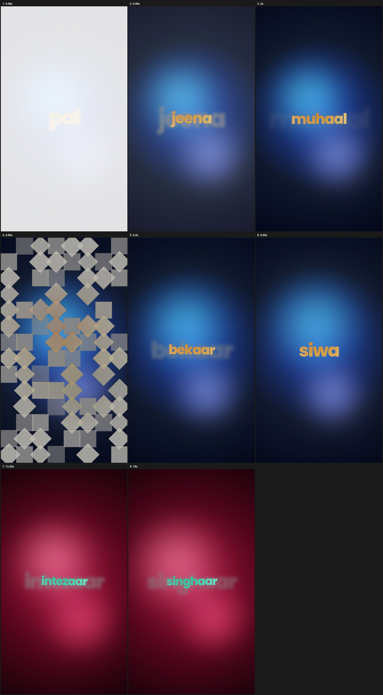

# Pal Pal — Epic 9:16 Kinetic Lyric Video

A production-grade, 9:16 vertical kinetic lyric video for the hit track **"Pal Pal"** by Afusic (Prod. by Ali Soomro), engineered with [Hyperframes](https://hyperframes.dev), [GSAP 3](https://greensock.com/gsap/), [Whisper.cpp](https://github.com/ggerganov/whisper.cpp) (`large-v3`), and [FFmpeg](https://ffmpeg.org).



---

## Visual & Motion Aesthetic

- **Aspect Ratio & Canvas**: 9:16 Vertical (`1080 × 1920` @ 30fps), tailored for Instagram Reels, TikTok, and YouTube Shorts.
- **Typography**: Lowercase **Poppins ExtraBold** (`800`) with tight tracking (`letter-spacing: -0.05em`) and responsive fluid sizing.
- **Dynamic Color Inversion**: Powered by CSS `mix-blend-mode: difference` against a black base:
  - Shines as **Warm Glowing Amber / Gold** over the deep blue gradient.
  - Inverts into **Electric Cyan / Mint** over the velvet wine red gradient.
  - Inverts to pitch-black during white beat flash frames.
- **Duotone Chromatic Shift**: Seamless transition from Deep Royal Midnight Blue (`#070d1e` / `#1d4ed8`) to Velvet Wine Red (`#180208` / `#9f1239`) at `09.45s`.
- **Living Background Orbs**: Four oversized, luminous radial orbs that breathe and drift on continuous sine wave paths.
- **Kinetic Word Animations**:
  - **Slam-In Entrance**: Words punch in from `scale: 1.55` with alternating angular tilts (`-3°` / `+3°`) snapping into place via `back.out(2.4)`.
  - **Vocal Sustain Drift**: Words never sit frozen during sung vocal holds; they gently expand and breathe (`scale: 1.0 → 1.12`).
  - **Ghost Echo Pulse**: Each word hit triggers a blurred ghost duplicate (`.word-echo`) that bursts outward (`scale: 1.0 → 1.9`, blur `0px → 14px`, fading to `0`).
- **Camera Kick & Beat Flashes**: The whole scene rig (`#camera-rig`) delivers a physical punch-kick (`y: -14px`, `scale: 1.04`) synced to 21 primary drum transients with simultaneous white screen flash frames.
- **Diamond Pixel-Mosaic Dissolves**: 112-tile staggered mosaic grid transitions between each of the 7 lyric lines.
- **35mm Analog Film Grain**: High-frequency procedural SVG noise stepped deterministically every 2 frames (`0.066s`).

---

## Synchronized Lyrics & Timing Map

Transcription was generated with millisecond accuracy using Whisper `large-v3` running locally on Apple Silicon Metal GPU:

| # | Lyric Line | Word Breakdown & Timestamps (seconds) | Transition Window |
|---|---|---|---|
| **1** | *pal-pal jeena muhaal mera tere bina* | `pal` (0.04) → `pal` (0.45) → `jeena` (0.90) → `muhaal` (1.84) → `mera` (2.64) → `tere` (3.46) → `bina` (4.22) | **Mosaic Dissolve**: 4.98s – 5.12s |
| **2** | *yeh saaray nashay bekaar* | `yeh` (5.12) → `saaray` (5.30) → `nashay` (5.70) → `bekaar` (6.10 – 7.28) | **Mosaic Dissolve**: 7.28s – 7.46s |
| **3** | *teri aankhon ke siwa* | `teri` (7.46) → `aankhon` (8.06) → `ke` (8.96) → `siwa` (9.27 – 9.65) | **Mosaic Dissolve + Duotone Shift**: 9.65s – 9.80s |
| **4** | *ghar nahi jaata, mein bahar* | `ghar` (9.80) → `nahi` (10.35) → `jaata` (10.70) → `mein` (11.08) → `bahar` (11.48 – 11.96) | **Mosaic Dissolve**: 11.96s – 12.08s |
| **5** | *rehta tera intezaar* | `rehta` (12.08) → `tera` (12.60) → `intezaar` (13.26 – 13.96) | **Mosaic Dissolve**: 13.96s – 14.08s |
| **6** | *mere khuwabon main aa naa* | `mere` (14.08) → `khuwabon` (14.66) → `main` (15.62) → `aa` (16.09) → `naa` (16.58 – 16.82) | **Mosaic Dissolve**: 16.82s – 16.92s |
| **7** | *kar ke solah singhaar* | `kar` (16.92) → `ke` (17.10) → `solah` (17.25) → `singhaar` (17.90 – 19.30) | **Outro Fade**: 18.75s – 19.50s |

---

## Complete Guide: How to Create This From Scratch

### Step 1: Environment & Prerequisites

Install required tools:
```bash
# 1. Node.js (v22+)
nvm install 22
nvm use 22

# 2. FFmpeg 7+ (ensure static ffmpeg & ffprobe are on PATH)
ffmpeg -version

# 3. Python 3.11 with audio analysis tooling
uv venv ~/video-tools --python 3.11
source ~/video-tools/bin/activate
pip install torch torchaudio librosa yt-dlp

# 4. Whisper.cpp with native GPU acceleration
git clone https://github.com/ggerganov/whisper.cpp.git ~/whisper.cpp
cd ~/whisper.cpp && GGML_METAL=1 make -j whisper-cli
cp build/bin/whisper-cli ~/.local/bin/

# Download the large-v3 model
mkdir -p ~/.cache/hyperframes/whisper/models
curl -L -o ~/.cache/hyperframes/whisper/models/ggml-large-v3.bin \
  https://huggingface.co/ggerganov/whisper.cpp/resolve/main/ggml-large-v3.bin
```

---

### Step 2: Audio Extraction & Segment Trimming

Download the track and trim the exact hook segment (`00:00:17.000` to `00:00:36.500`, duration: 19.5s):
```bash
yt-dlp -x --audio-format mp3 -o "source_audio.%(ext)s" "https://www.youtube.com/watch?v=8of5w7RgcTc"

ffmpeg -y -ss 00:00:17.000 -to 00:00:36.500 -i source_audio.mp3 \
  -c:a libmp3lame -b:a 320k assets/audio.mp3
```

---

### Step 3: Millisecond-Precision Word Alignment

Transcribe the trimmed audio with `whisper-cli` using the `large-v3` model and word-level timestamp generation:
```bash
whisper-cli -m ~/.cache/hyperframes/whisper/models/ggml-large-v3.bin \
  -f assets/audio.mp3 \
  -l ur \
  --output-json \
  -of transcription
```
The output JSON yields exact word start/end bounds (`[start, end]`). Align these bounds with the lyric text array in JavaScript.

---

### Step 4: Beat Detection for Visual Synchronization

Detect musical transients to drive camera kicks and white flash frames:
```python
import librosa
import numpy as np

y, sr = librosa.load("assets/audio.mp3")
tempo, beat_frames = librosa.beat.beat_track(y=y, sr=sr)
beat_times = librosa.frames_to_time(beat_frames, sr=sr)

# Strong beat transients:
# [0.12, 0.92, 1.78, 2.64, 3.58, 4.58, 5.14, 6.10, 7.42, 8.18, 9.72, 10.74, 11.62, 12.02, 12.96, 14.02, 15.00, 16.22, 17.04, 17.72, 18.78]
```

---

### Step 5: Visual Styling & Kinetic Animation Mechanics

#### 1. Why Difference Blend Mode?
```css
#root {
  isolation: isolate;
  background: #000000;
}
#lyrics-stage {
  mix-blend-mode: difference;
}
```
Setting white text (`#ffffff`) inside `mix-blend-mode: difference` causes the browser to compute `| background_color - 255 |`. 
- Over royal blue `rgb(30, 64, 175)` $\rightarrow$ yields amber/gold `rgb(225, 191, 80)`.
- Over wine red `rgb(159, 18, 57)` $\rightarrow$ yields cyan/mint `rgb(96, 237, 198)`.
- Over white flash `rgb(255, 255, 255)` $\rightarrow$ yields obsidian black `rgb(0, 0, 0)`.

#### 2. Avoiding Integer-Pixel Snapping (Hyperframes Contract)
Do **not** animate CSS `letter-spacing` directly in GSAP: `letter-spacing` snaps to integer screen pixels, causing stutter during frame-by-frame rendering. Keep letter-spacing static in CSS (`letter-spacing: -0.05em`) and animate subpixel GPU transforms:
- `scale`
- `rotation`
- `x`, `y`
- `opacity`

#### 3. Kinetic Curve Structure
Each word utilizes a 3-tier animation curve:
```javascript
// 1. Instant reveal
tl.set(card, { autoAlpha: 1 }, w.start);

// 2. High-impact slam-in
tl.fromTo(mainWord,
  { scale: 1.55, rotation: (i % 2 === 0 ? -3 : 3), y: 22, opacity: 0 },
  { scale: 1.0, rotation: 0, y: 0, opacity: 1, duration: snapDur, ease: "back.out(2.4)" },
  w.start
);

// 3. Living sustain drift during vocal hold
if (dur > snapDur) {
  tl.to(mainWord,
    { scale: 1.12, duration: dur - snapDur, ease: "power1.out" },
    w.start + snapDur
  );
}

// 4. Ghost echo burst
tl.fromTo(echoWord,
  { scale: 1.0, opacity: 0.85, filter: "blur(0px)" },
  { scale: 1.9, opacity: 0, filter: "blur(14px)", duration: dur * 0.75, ease: "power2.out" },
  w.start
);

// 5. Hide card at completion
tl.set(card, { autoAlpha: 0 }, w.end);
```

---

### Step 6: Master Timeline Registration

Hyperframes operates as a deterministic, seek-based renderer. All animations must be registered on `window.__timelines` under the root composition ID:

```html
<div id="root" data-composition-id="main" data-start="0" data-duration="19.5" data-width="1080" data-height="1920">
  <audio id="track-audio" src="assets/audio.mp3" data-start="0" data-duration="19.5" preload="auto"></audio>
  ...
</div>

<script>
  const tl = gsap.timeline({ paused: true });
  // Add all animations (background, words, beat kicks, dissolves, grain) to tl
  tl.seek(0);
  window.__timelines = window.__timelines || {};
  window.__timelines["main"] = tl;
</script>
```

---

### Step 7: Verification & Snapshots

Run static lint, WCAG contrast, and motion validation:
```bash
npx --yes hyperframes@0.8.143 check --json
```

Capture key visual verification frames across the timeline:
```bash
npx --yes hyperframes@0.8.143 snapshot \
  --at 0.08,0.98,2.0,5.05,6.2,9.55,13.35,18.0 \
  --no-end \
  -o snapshots
```

---

### Step 8: Rendering the Final MP4

Render with hardware GPU acceleration:
```bash
npx --yes hyperframes@0.8.143 render -o out.mp4
```

Verify stream attributes with `ffprobe`:
```bash
ffprobe -v error -show_entries format=duration,size,bit_rate:stream=codec_name,width,height -of json out.mp4
```

---

## Project Structure

```
pal-pal-lyric-video/
├── assets/
│   ├── audio.mp3                  # Master trimmed vocal audio track (19.5s, 320kbps)
│   ├── gsap.min.js                # GreenSock Animation Platform v3.12.5
│   └── fonts/
│       └── Poppins-ExtraBold.ttf  # Localized static font asset (800 weight)
├── snapshots/
│   ├── contact-sheet.jpg          # 8-frame grid overview for visual QA
│   ├── frame-00-at-0.08s.png      # 'pal' white beat flash impact
│   ├── frame-01-at-0.98s.png      # 'jeena' entrance slam + ghost echo pulse
│   ├── frame-02-at-2s.png         # 'muhaal' sustained vocal hold
│   ├── frame-03-at-5.05s.png      # Diamond pixel-mosaic dissolve
│   ├── frame-04-at-6.2s.png       # 'bekaar' amber inversion on blue
│   ├── frame-05-at-9.55s.png      # Duotone shift (Deep Blue -> Wine Red)
│   ├── frame-06-at-13.35s.png     # 'intezaar' cyan inversion on red
│   └── frame-07-at-18s.png        # 'singhaar' final hook climax
├── hyperframes.json               # Hyperframes project and registry configuration
├── index.html                     # Master composition, DOM hierarchy, and GSAP timeline
├── meta.json                      # Project metadata
├── package.json                   # NPM run scripts and tooling dependencies
├── out.mp4                        # Full rendered 9:16 vertical MP4 video (32.6 MB)
└── README.md                      # Comprehensive documentation and creation guideline
```

---

## Quick Start / Reproduce

```bash
# Clone the repository
git clone https://github.com/algoreetham/pal-pal-lyric-video.git
cd pal-pal-lyric-video

# Launch interactive browser preview
npx --yes hyperframes@0.8.143 preview

# Run automated validation check
npx --yes hyperframes@0.8.143 check

# Render MP4 video
npx --yes hyperframes@0.8.143 render -o out.mp4
```

---

## Credits

- **Vocals / Music**: *Pal Pal* by Afusic (Produced by Ali Soomro)
- **Engine**: [Hyperframes](https://github.com/heygen-com/hyperframes)
- **Animation**: [GSAP](https://gsap.com)
- **Transcription**: [Whisper.cpp](https://github.com/ggerganov/whisper.cpp)
